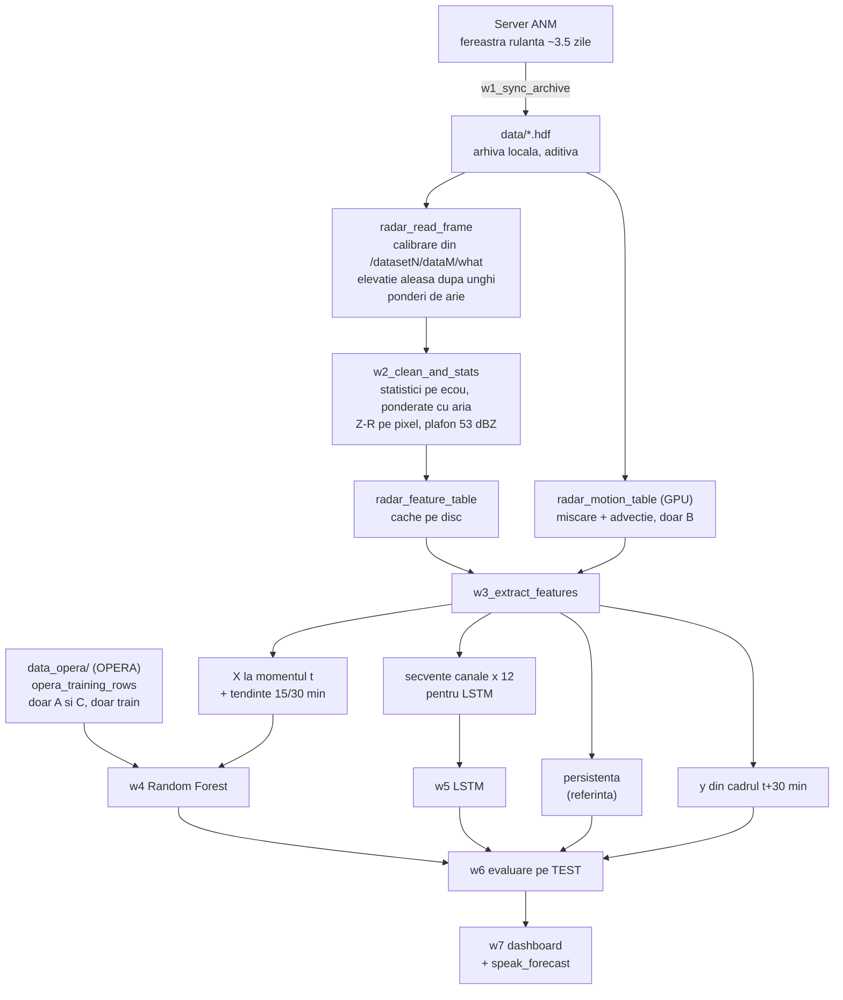
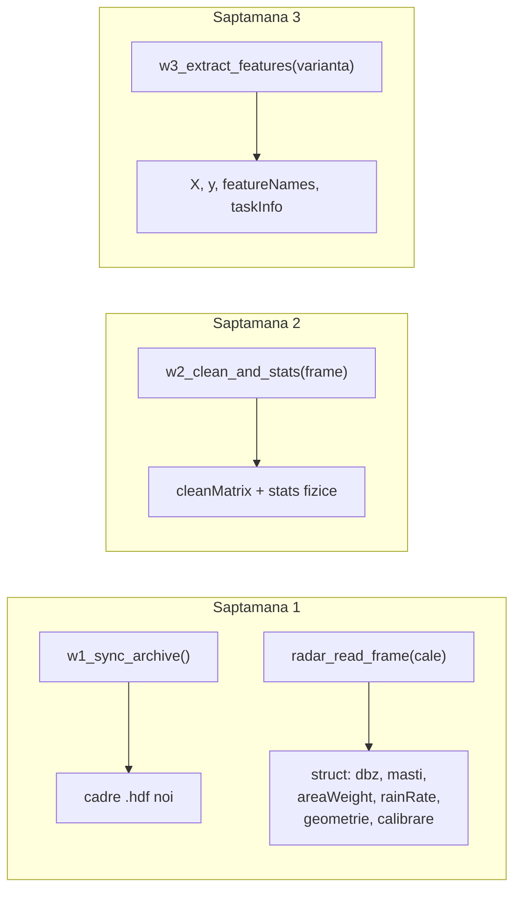
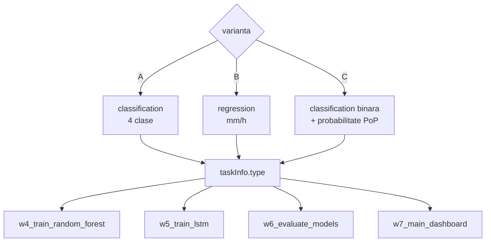

# TIM Radar Lab: diagrame de flux

## 1. Fluxul de date, de la fișier la prognoză



## 2. Separarea temporală a datelor

Splitul este **cronologic**, nu aleator, iar între segmente există un **embargo**.
Fără embargo, ultimele exemple de antrenament ar avea ținta căzând în intervalul
de validare.

```
|<------------- train 70% ------------->|xxxx|<- val ->|xxxx|<- test ->|
                                         ^^^^           ^^^^
                                       embargo        embargo
                            (= fereastra de intrare + orizontul)
```

Embargoul se **scade din** segmentele de validare și test, nu se inserează între
blocuri de dimensiune completă: train rămâne exact 70%, iar val și test sunt
fiecare 15% *minus* lungimea embargoului.

Lungimea embargoului este `istoric + orizont` (implicit 12 + 6 = 18 cadre), nu
doar orizontul. Amprenta unui eșantion în serie cuprinde și cadrele pe care le
citește ca intrare; cu un embargo egal doar cu orizontul, primele eșantioane de
validare ar împărți cadre de intrare cu ultimele eșantioane de antrenament.

## 3. Ce intră și ce iese din fiecare modul



## 4. Decizia asupra tipului de problemă

Tipul problemei vine explicit din `taskInfo`, produs de `w3_extract_features`;
nu se deduce din valorile etichetelor:



## 5. Cum se citește tabelul din Săptămâna 6

```
Model                      R2      RMSE     MAE    MaxError  SkillVsPersistenta
-------------------------------------------------------------------------------
Random Forest            0.895   0.0089  0.0055   0.041           > 0   <- valoare adaugata
LSTM                     0.810   0.0091  0.0061   0.038           > 0
Persistenta (referinta)  0.775   0.0106  0.0068   0.052             0   <- pragul real
Climatologie (medie)    -0.043   0.0224  0.0180   0.074           < 0
```

Cifrele sunt ilustrative; citiți-le din rularea voastră.

`Climatologie (medie)` are $R^2$ **ușor negativ**, nu exact zero: media este
estimată pe segmentul de antrenament, nu pe cel evaluat. Un $R^2$ exact 0 pe
acest rând ar însemna că referința a fost calculată din chiar etichetele pe care
le măsoară.

Cifra care contează este `SkillVsPersistenta`. Un $R^2$ mare, singur, poate
ascunde un model mai slab decât „vremea rămâne neschimbată”.
